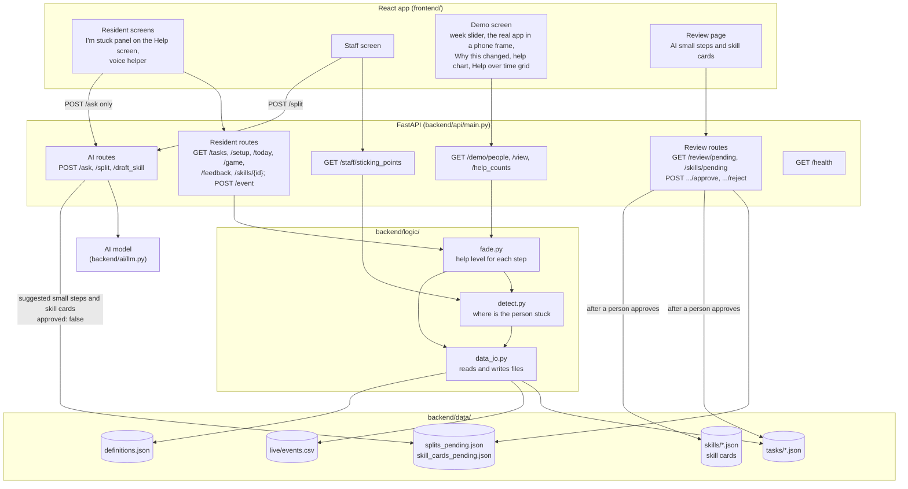

# Architecture

Carryover is a React app (port 5173) talking to a FastAPI backend (port 8000). The backend keeps its data in plain files, so there is no database to set up.

`GET /health` is a plain liveness check.

## How a day's screen is built

1. The resident screen asks for today's view of a task.
2. `fade.build_view()` loads the task file and the person's earlier events.
3. For each step it works out the help level (`split`, `hint` or `hide`) from how the last sessions went. The rules and numbers are in `definitions.json`. Some help (`hint`) shows the full step text; there are no short names.
4. Each step also carries `safety`, `picture`, `video` and `base_skills`. `safety` is shown as a CAUTION line at every help level, even when the step is folded.
5. The first time a task is opened, the view carries the task's `first_time_question`. The answer is asked and logged (`device_check_answer`). The rules in `fade.py` say that after a No every step starts at most help and `new_device` is true, but this is not yet connected in the resident app: today's view is built from earlier weeks only, so the answer does not reach it. After that the level shown last time carries over and fades the normal way.
6. The view also says whether to show the start push, the safety card, a refresher, and which check questions are due.
7. The screen shows what the view says and never picks a help level itself.

In the demo, the week slider sets the week. Only events from earlier weeks are used, so the app can't see the future.

## How AI steps reach a resident

1. `POST /split` asks the model for small steps for one hard step.
2. The answer is checked in code, then saved to `splits_pending.json` with `approved: false`.
3. A person opens the Review page, edits the words if they want, and approves.
4. Only then are the small steps written into the task file. Until that point no resident sees them.
5. AI-drafted skill cards take the same path: `POST /draft_skill` saves to `skill_cards_pending.json`, and the Review page approves them into `backend/data/skills/`. No button in the app calls `/draft_skill` yet; it is called through the API (see http://localhost:8000/docs).
